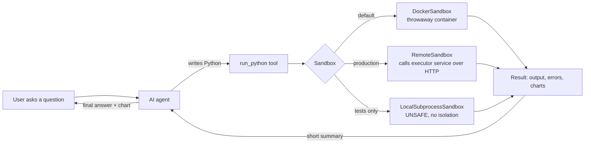
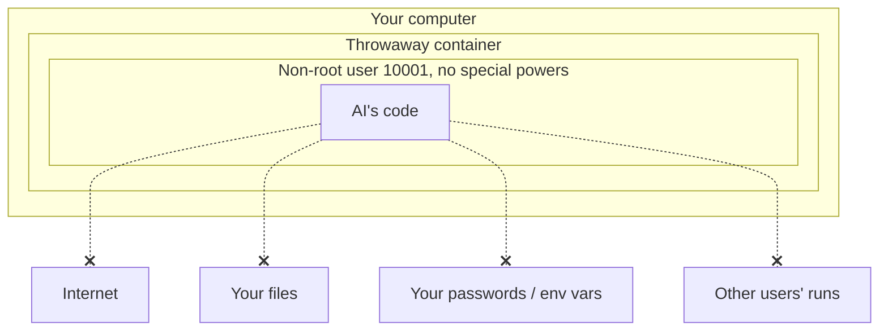
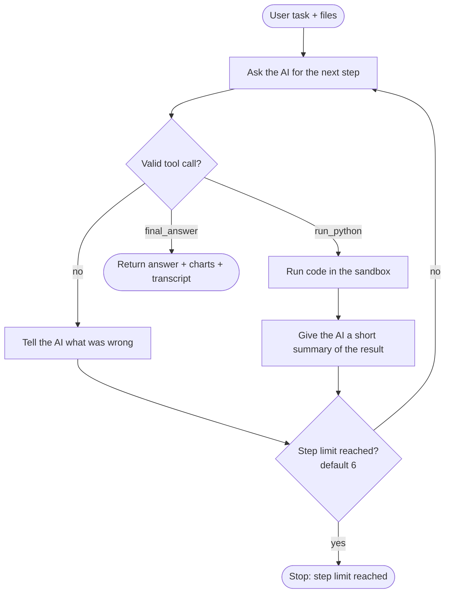
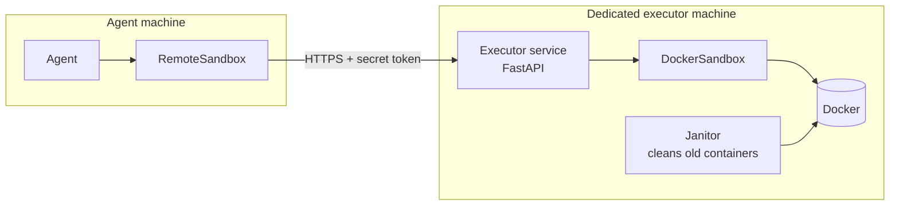

# Sandboxed Code Executor: a simple guide

This guide explains the project from start to finish in plain language: what it does, how a
piece of code travels through the system, how each part keeps you safe, and how to run it
yourself and what you should see.

> The diagrams use [Mermaid](https://mermaid.js.org/). They render on GitHub, and in VS Code
> with the "Markdown Preview Mermaid Support" extension.

---

## 1. What is this project?

AI assistants (LLMs) can write Python to answer questions like *"what was our best sales
month? draw me a chart."* Something then has to **run** that code.

Running AI-written code is risky. The code might:

- have bugs (an infinite loop, using all the memory),
- or be **malicious**. If the AI read a web page or file with hidden instructions ("prompt
  injection"), it might write code that steals your passwords or deletes files.

This project is a **safe room for running that code**. Code goes in, results come out, and the
code can never touch your computer, your files, your secrets or the internet.

**Analogy:** think of a bank's cash-counting machine behind thick glass. You pass money through
a slot, it gets counted, and a receipt comes back. You can never reach inside, and whatever
happens inside cannot reach you.

---

## 2. The big picture



There are three building blocks:

| Block | What it is | Where it lives |
|---|---|---|
| **Agent** | the loop that asks the AI for code, runs it and shows the AI the result | `agentkit/agents/code_interpreter.py` |
| **Sandbox** | the safe room that runs one piece of code | `agentkit/sandbox/` |
| **Executor service** | a small web server that owns the safe room, so the agent never controls Docker directly | `services/executor/` |

---

## 3. The journey of one piece of code (end to end)

Here is what happens when the AI says *"run this Python"*.

```mermaid
sequenceDiagram
    participant AI as AI model
    participant Agent as Agent
    participant Host as DockerSandbox (your machine)
    participant Box as Container (the safe room)
    participant Runner as runner.py (inside)
    participant Code as AI's code (main.py)

    AI->>Agent: {"tool":"run_python","arguments":{"code":"..."}}
    Agent->>Agent: check the reply is valid (strict rules)
    Agent->>Host: ExecutionRequest(code, files)
    Host->>Host: check size limits, wait for a free slot
    Host->>Box: docker run (no network, read-only, limits...)
    Host->>Runner: send code + files on stdin (JSON)
    Runner->>Runner: write main.py + files into /workspace
    Runner->>Code: start python main.py with a timer
    Code-->>Runner: prints output, saves charts to output/
    Runner->>Runner: stop leftover processes, collect files safely
    Runner-->>Host: ONE line of JSON (with a secret code)
    Box-->>Host: container is deleted
    Host->>Host: check the JSON, cut it to size, clean file names
    Host-->>Agent: ExecutionResult (status, output, charts)
    Agent-->>AI: short text summary (no huge data)
```

The same steps in words:

1. **The AI replies** with a tool call written as JSON.
2. **The agent checks the reply.** If it is broken or names a file that doesn't exist, the AI
   is told what was wrong and tries again.
3. **The sandbox checks limits.** Is the code too long? Too many files? Too long a timeout?
   If so, the status is `rejected`.
4. **It waits for a free slot.** Only 4 runs at once and at most 16 waiting. Beyond that the
   answer is "busy, try later".
5. **A brand-new container starts** with every safety setting switched on (section 4).
6. **The code and files go in through stdin**, like typing into the container. No folders
   from your computer are shared.
7. **Inside, `runner.py` takes over.** It writes the files, runs the AI's code with a timer,
   records the output, and collects anything saved in `output/`.
8. **The runner prints one result line** containing a secret code (a *nonce*) that only the
   host and the runner know.
9. **The container is deleted.** Nothing survives to the next run.
10. **The host double-checks everything**, because the AI's code could have tampered with
    the result. The result must carry the right secret code, follow the exact format, and
    stay within the size limits.
11. **The agent gives the AI a short summary**: status, output, the last lines of any error,
    and chart names. It never includes the raw image data.

---

## 4. How the safe room keeps you safe

No single wall is trusted. There are many independent walls, so if one fails the others still
hold. This is called **defence in depth**.



| Danger | What stops it |
|---|---|
| Reading your files | No folders are shared. The container's own system files are read-only. |
| Stealing secrets (API keys) | Only 4 harmless settings are passed in. Your environment variables never enter. |
| Using the internet | `--network none`: the container has no network card except "localhost". |
| Infinite loop | A timer inside kills the code. A second timer outside kills the whole container. |
| Using all memory | Memory capped at 512 MB with no swap. Huge allocations fail immediately. |
| Fork bomb (endless copies of itself) | At most 64 processes. |
| Filling the disk | Only small temporary RAM disks: 64 MB `/workspace`, 32 MB `/tmp`. |
| Printing gigabytes | Only the first and last 32 KB of output are kept. |
| Becoming admin (root) | Runs as a normal user, every special power removed, no-new-privileges set. |
| Leaving a program running | Every leftover process is killed, and the container is deleted. |
| Sneaking files out with shortcuts (symlinks) | Only real, ordinary files are returned. Shortcuts are skipped. |
| Faking the result | The secret code, strict format checks, and size caps on the host. |
| Coming back next time | Each run gets a brand-new container. |

**Fail closed:** if Docker isn't running, the image is missing, or a limit can't be applied,
the project **refuses to run code**. It never quietly falls back to an unsafe mode.

---

## 5. How the agent thinks (the loop)



- The AI may only use two tools: `run_python` and `final_answer`.
- If the code fails, the AI sees the end of the error (the most useful part) and can fix it.
- Charts made in one step become files that later steps can use.
- Every step is recorded (code, status, time) for later review.

---

## 6. Production setup: why there is a separate service

Whoever controls Docker effectively controls the whole machine. So in production the agent
does **not** talk to Docker. It sends code over HTTP to the executor service, which runs on
its own separate machine.



| Request | Answer |
|---|---|
| `POST /v1/executions` with a valid token | `200` + the result |
| missing or wrong token | `401` |
| body too large | `413` |
| badly formed request | `422` |
| too busy | `429` + `Retry-After` |
| Docker / image unavailable | `503` |
| `GET /healthz` | is the process alive? |
| `GET /readyz` | is Docker ready to run code? |

---

## 7. Every status you can get back

| Status | Meaning | Example |
|---|---|---|
| `ok` | code finished normally | `print(1+1)` |
| `error` | code crashed or exited with an error | `1/0` |
| `timeout` | ran too long and was killed | `while True: pass` |
| `oom` | used too much memory | `b'a' * 2_000_000_000` |
| `output_limit` | sent back far too much data | flooding the output |
| `rejected` | the request broke a limit before running | 11 input files |
| `sandbox_error` | something went wrong in the machinery itself | runner returned garbage |

---

## 8. Folder map

```
sandbox-runner/
├── agentkit/
│   ├── tools.py, router.py, llm.py   strict tool calls (Project 1)
│   ├── context.py                    token budgets (Project 2)
│   ├── sandbox/                      the safe room (Project 4)
│   │   ├── docker.py                 starts the hardened container
│   │   ├── runner.py                 runs INSIDE the container
│   │   ├── results.py                double-checks what comes back
│   │   ├── config.py                 all limits in one place
│   │   └── ...                       models, limiter, janitor, remote client, tool
│   └── agents/code_interpreter.py    the AI agent loop
├── services/executor/                web service + Dockerfile + docker-compose
├── sandbox_image/                    recipe for the container image
├── docs/                             SECURITY.md (deep dive) and this guide
├── demo_sandbox.py                   agent demo: CSV → chart
├── demo_attacks.py                   tries 15 attacks, shows each one blocked
└── tests/                            unit tests + attack tests
```

---

## 9. How to run it

### What you need

- **Python 3.10+** (3.12 recommended)
- **Docker**: Docker Desktop on Windows/macOS, Docker Engine on Linux. **Start it** before
  running anything.

### Step 1: Install

Windows (PowerShell):

```powershell
cd C:\Users\Arun\Desktop\sandbox-runner
py -3.12 -m venv .venv
.\.venv\Scripts\Activate.ps1
pip install -e ".[dev,sandbox,service]"
```

macOS / Linux:

```bash
python3 -m venv .venv && source .venv/bin/activate
pip install -e ".[dev,sandbox,service]"
```

### Step 2: Build the safe-room image (once, takes a few minutes)

```bash
docker build -t agentkit-sandbox:dev sandbox_image/
```

**Expected:** it ends with `naming to docker.io/library/agentkit-sandbox:dev ... done`.
Check with:

```bash
docker image ls agentkit-sandbox
# REPOSITORY         TAG   IMAGE ID       CREATED        SIZE
# agentkit-sandbox   dev   2ba87c4c2355   1 minute ago   ~730MB
```

### Step 3: Run the tests

```bash
pytest            # everything; Docker tests skip themselves if Docker is off
pytest -m docker  # only the real-Docker and attack tests
```

**Expected:**

```
137 passed, 3 skipped in ~150s
```

The 3 skips are normal: 2 tests only run on Linux/macOS hosts, and 1 slow test is opt-in.
Without Docker you will see `111 passed` and the Docker tests skipped, with a reason such as
"sandbox image ... missing".

### Step 4: Watch the attacks get blocked

```bash
python demo_attacks.py
```

**Expected output:**

```
attack                           status          time  result
-------------------------------------------------------------------
persistence across runs          ok              0.0s  BLOCKED
read host files                  ok              3.1s  BLOCKED
read host env vars               ok              1.9s  BLOCKED
network (DNS + TCP)              ok              1.5s  BLOCKED
infinite loop                    timeout         5.2s  BLOCKED
allocate 2 GB                    oom            10.1s  BLOCKED
fork bomb                        timeout        10.8s  BLOCKED
fill disk (1 GB)                 ok              4.7s  BLOCKED
print 100 MB                     ok              3.1s  BLOCKED
write /usr, /etc, /opt/runner    ok              3.4s  BLOCKED
privilege escalation             ok              2.6s  BLOCKED
artifact symlink -> /etc/passwd  ok              1.6s  BLOCKED
ignore SIGTERM, sleep forever    timeout         3.6s  BLOCKED
leave background process         ok              1.7s  BLOCKED
forge runner output              error           1.3s  BLOCKED

15/15 attacks blocked
```

`ok` in the status column is fine. It means the hostile code ran but could not do any harm.
Times vary by machine.

### Step 5: Run the AI agent demo

```bash
python demo_sandbox.py
```

The "AI" here is scripted (no API key needed). It deliberately makes a mistake first, so you
can watch it recover.

**Expected output (shortened):**

```
sandbox: {'backend': 'docker', 'isolated': True, ...}

--- fed back to the model ---
status: error | exit code: 1 | ... ms
--- stderr (last lines) ---
KeyError: 'profit'

--- fed back to the model ---
status: ok | exit code: 0 | ... ms
artifacts saved: pnl.png (37.3 KB, image/png)
  month  revenue  cost  profit
2024-01      120    80      40
...
mean profit: 59.17
best month: 2024-06 profit 76

=== transcript ===
step 1: run_python -> error
step 2: run_python -> ok
step 3: final_answer -> final_answer

answer: Profit grew from 40 to 76; June was the best month. Chart: pnl.png
saved artifact ...\sandbox-runner\pnl.png (38179 bytes, image/png)
```

A chart file **`pnl.png`** appears in the project folder, showing revenue, cost and profit per
month.

(`python demo_sandbox.py --local` runs without Docker, but with no protection at all, and it
fails unless pandas is installed locally.)

### Step 6: Run the executor web service (optional)

Windows (PowerShell):

```powershell
$env:AGENTKIT_EXECUTOR_TOKEN = "my-secret-token"
uvicorn services.executor.app:app --port 8080
```

macOS / Linux:

```bash
export AGENTKIT_EXECUTOR_TOKEN=my-secret-token
uvicorn services.executor.app:app --port 8080
```

In a second terminal:

```bash
curl http://localhost:8080/readyz
# {"status":"ready"}

curl -X POST http://localhost:8080/v1/executions \
  -H "Authorization: Bearer my-secret-token" -H "Content-Type: application/json" \
  -d '{"code": "print(sum(range(10)))"}'
```

On Windows PowerShell, write the last line as
`-d '{\"code\": \"print(sum(range(10)))\"}'` and use `curl.exe`.

**Expected:**

```json
{"run_id":"620c...","status":"ok","exit_code":0,"stdout":"45\n","stderr":"",
 "artifacts":[],"duration_ms":3125,"backend":"docker",
 "limits":{"isolated":true,"network":"none","memory_mb":512,"pids_limit":64,...}}
```

Without the token you get `401`. Without `AGENTKIT_EXECUTOR_TOKEN` set, the service refuses
to start. For local experiments only, set `AGENTKIT_EXECUTOR_DEV=1` to allow that.

### Step 7: Use it from your own Python code

```python
from agentkit.sandbox import DockerSandbox, ExecutionRequest, InputFile

sandbox = DockerSandbox()
result = sandbox.run_sync(ExecutionRequest(
    code="import pandas as pd\nprint(pd.read_csv('d.csv').sum())",
    files=[InputFile.from_bytes("d.csv", b"a,b\n1,2\n3,4\n")],
))
print(result.status)   # ExecutionStatus.OK
print(result.stdout)   # a    4 / b    6
```

---

## 10. Common problems

| You see | Fix |
|---|---|
| `SandboxUnavailableError: Docker daemon is not reachable` | Start Docker Desktop and wait until it says "running". |
| `sandbox image 'agentkit-sandbox:dev' not found` | Run `docker build -t agentkit-sandbox:dev sandbox_image/`. |
| Image build fails with `Read timed out` | The network was slow. Run the build command again. |
| Docker tests show as skipped | Docker is off, or the image isn't built. The skip reason says which. |
| Every run is slow (5+ s) | Normal on Docker Desktop: each run starts a fresh container and loads pandas. Linux is faster. |
| `test_image_runner_matches_package_runner` fails | You edited `agentkit/sandbox/runner.py`. Copy it to `sandbox_image/runner.py` and rebuild the image. |

---

## 11. Settings you can change

All limits can be set with environment variables named `AGENTKIT_SANDBOX_<NAME>`:

| Variable | Default | Meaning |
|---|---|---|
| `AGENTKIT_SANDBOX_TIMEOUT_S` | 10 | seconds before code is stopped (max 60) |
| `AGENTKIT_SANDBOX_MEMORY_MB` | 512 | memory limit |
| `AGENTKIT_SANDBOX_CPUS` | 1.0 | CPU share |
| `AGENTKIT_SANDBOX_PIDS_LIMIT` | 64 | max processes |
| `AGENTKIT_SANDBOX_MAX_CONCURRENCY` | 4 | runs at the same time |
| `AGENTKIT_SANDBOX_RUNTIME` | (none) | `runsc` for gVisor: stronger isolation if installed |
| `AGENTKIT_SANDBOX_IMAGE` | `agentkit-sandbox:dev` | in production, pin by digest (`...@sha256:...`) |

Limits cannot be set to "unlimited". Values that are too low or inconsistent are refused at
startup.

---

## 12. Learn more

- [SECURITY.md](SECURITY.md): the full threat model, every safety layer, and known
  limitations (for example, containers share the host's kernel; use gVisor or microVMs for
  untrusted multi-user setups).
- [README.md](../README.md): project table, design decisions, exercises and interview points.
